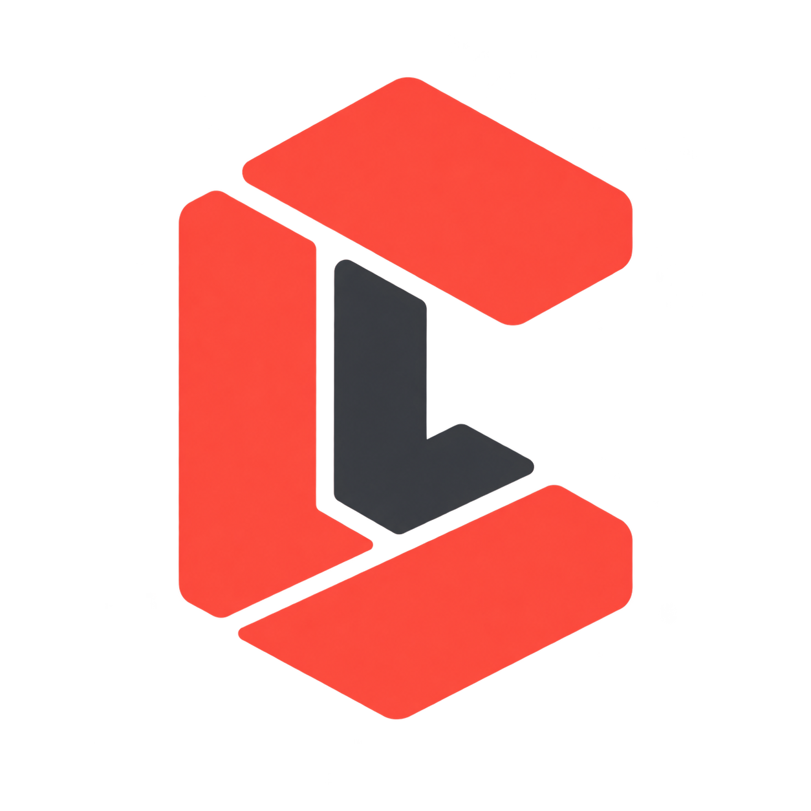

<h1 align="center">Laracanon</h1>

<p align="center">
  
</p>

<p align="center">
  <a href="https://github.com/IsaacHatilima/laracanon/actions/workflows/tests.yml"></a>
  <a href="https://packagist.org/packages/isaachatilima/laracanon"></a>
  <a href="https://packagist.org/packages/isaachatilima/laracanon"></a>
  <a href="LICENSE"></a>
  <a href="https://packagist.org/packages/isaachatilima/laracanon"></a>
</p>

Laracanon installs Laravel skills for coding agents into an existing Laravel application: conventions for actions, controllers, data objects, models, requests, tests and more. It maintains those skills itself, in [resources/skills](resources/skills).

## Install

```sh
composer require --dev isaachatilima/laracanon
php artisan canon:list
php artisan canon:install --dry-run
php artisan canon:install
```

The package supports PHP 8.2+ and Laravel 11, 12, and 13. The shipped Laravel conventions target Laravel 13 attributes; follow the application's installed framework version. Installation integrates Laravel Boost and preserves existing dependency constraints.

Omit skill names to install every bundled skill, or select them explicitly:

```sh
php artisan canon:install laravel-actions laravel-data laravel-controllers
```

## Installed files

| Location | Content |
|---|---|
| `.agents/skills/laravel-<name>/` | One shared copy of each selected skill. Codex reads this directory directly. |
| `.ai/skills/`, `.claude/skills/` | Relative links to the shared skills for Laravel Boost and Claude Code. |
| `.ai/laracanon/state.json` | Managed-file ownership and hashes. |

Skill support files, such as Insights/PHPStan configurations and API response templates, stay beside their skill instructions. Installing a skill does not apply those templates to the application or install its suggested packages. Laravel Boost integration can install Boost if missing and refresh its resources; see [the integration details](docs/boost-integration.md).

Dry runs write no files and run no processes. Repeat installs update unchanged managed files, preserve local edits, and report conflicts. Unrelated files and existing Composer constraints are preserved. Files owned by a previous version of the same selected item are retired only when they remain unchanged.

Upgrading from the previous three-copy layout replaces verified managed copies with relative links. A changed or unowned copy is preserved and reported as a conflict. Reconcile that copy before retrying. Symlinks must be supported; the installer reports an error instead of silently making duplicate copies. `.codex/skills/` is unnecessary: Codex's project skill directory is `.agents/skills/`.

## Upgrading from 0.1.x

Laracanon no longer installs the factory workflow, its eight agents, or the shared `catalog.md`; it installs only its Laravel skills. Nothing is removed from your project: files an earlier version wrote under `.agents/skills/factory/`, `.agents/skills/catalog.md`, `.claude/agents/`, `.codex/agents/`, and their links in `.ai/skills/` and `.claude/skills/` stay where they are, but Laracanon no longer updates them. Delete them if you don't use the factory. Its source is in [IsaacHatilima/skills](https://github.com/IsaacHatilima/skills).

The Laravel skills themselves are unchanged, so reinstalling leaves them as they are.

## Writing skills

Each skill is a folder in [resources/skills](resources/skills) named `laravel-<name>`, holding a `SKILL.md` whose frontmatter `name` matches the folder and has a nonempty `description`, plus any support files beside it. Adding a folder adds a skill; there is no manifest to update. Hidden files are never installed, and symlinks or file names that are unsafe install paths are rejected.

A project-specific catalog remains supported through `laracanon.items_path`. Point it at a directory of skill folders in the same format, or at Markdown items with the existing rules, dependencies, configuration, and authored-skill format; package tests use isolated fixtures for that interface.

## Development

```sh
composer install
vendor/bin/phpunit tests/Unit/Items tests/Integration/Items/CatalogInstallationTest.php
vendor/bin/pint --test src tests
```

Use focused tests for the paths and flows you change.

To release, raise the version in `VERSION` in the same PR. After it merges and the complete `Tests` workflow passes for that `main` commit, the release workflow pushes the matching `vX.Y.Z` tag and creates a GitHub release; Packagist's auto-update hook indexes the tag. Failed tests prevent publication. Rerunning the successful main-branch Tests workflow can retry a release after a transient failure.

Laravel 11 compatibility tests use an explicit CI-only advisory allowlist because that framework line is outside security support. Advisory reporting stays enabled; the allowlist is created only in the isolated compatibility job and is not part of an application's Composer configuration.
