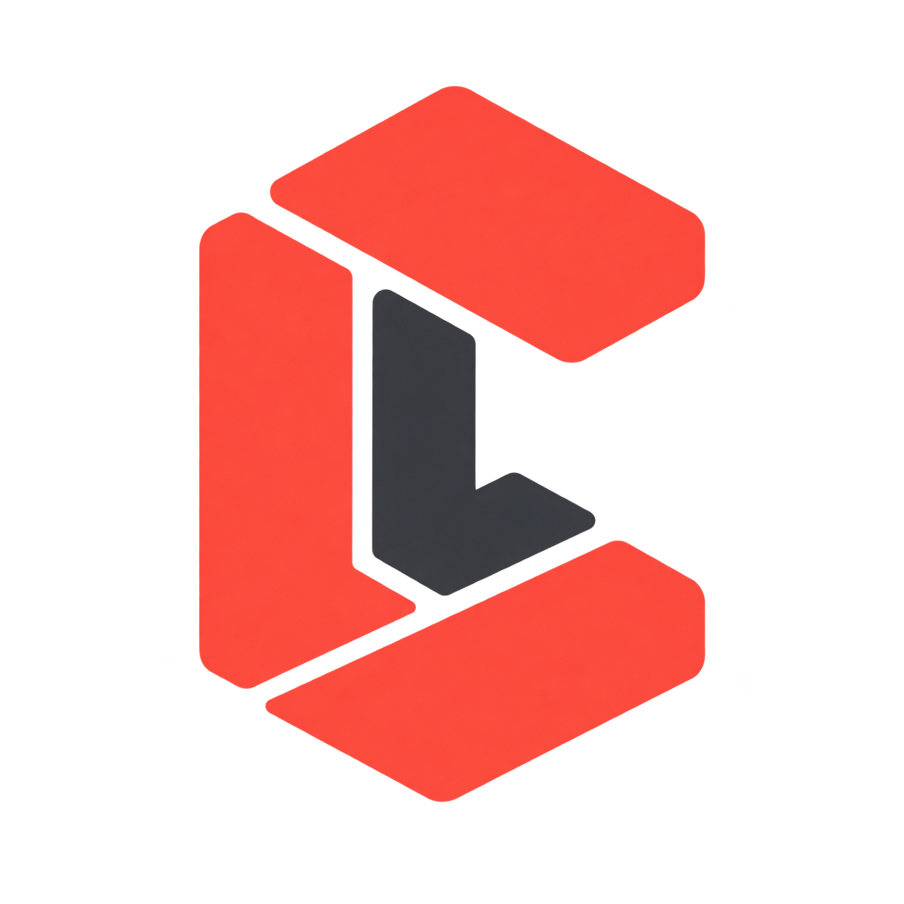

<h1 align="center">Laracanon</h1>

<p align="center">
  
</p>

<p align="center">
  <a href="https://github.com/IsaacHatilima/laracanon/actions/workflows/tests.yml"></a>
  <a href="https://packagist.org/packages/isaachatilima/laracanon"></a>
  <a href="https://packagist.org/packages/isaachatilima/laracanon"></a>
  <a href="LICENSE"></a>
  <a href="https://packagist.org/packages/isaachatilima/laracanon"></a>
</p>

Laracanon installs the factory workflow and Laravel skills from [IsaacHatilima/skills](https://github.com/IsaacHatilima/skills) into an existing Laravel application.

## Install

```sh
composer require --dev isaachatilima/laracanon
php artisan canon:list
php artisan canon:install --dry-run
php artisan canon:install
```

The package supports PHP 8.2+ and Laravel 11, 12, and 13. The shipped Laravel conventions target Laravel 13 attributes; follow the application's installed framework version. Installation integrates Laravel Boost and preserves existing dependency constraints.

Omit item names to install the complete delivered library, or select them explicitly:

```sh
php artisan canon:install factory laravel-actions laravel-data laravel-controllers
```

Invoke `/factory <feature request>` in Claude Code or `$factory <feature request>` in Codex after installation. Install the complete catalog for factory to have every Laravel capability available. A selected subset can block a job that needs an omitted skill.

## Delivered files

| Location | Content |
|---|---|
| `.ai/skills/`, `.agents/skills/`, `.claude/skills/` | Group-prefixed Laravel skills, the factory command and its complete bundle, and a catalog of available skills. |
| `.claude/agents/` | Eight factory child agents rendered for Claude Code. |
| `.codex/agents/` | The same factory roles rendered for Codex. |
| `.ai/laracanon/state.json` | Managed-file ownership and hashes. |

Skill support files, such as Insights/PHPStan configurations and API response templates, stay beside their skill instructions. Installing a skill does not apply those templates to the application or install its suggested packages. Laravel Boost integration can install Boost if missing and refresh its resources; see [the integration details](docs/boost-integration.md).

Dry runs write no files and run no processes. Repeat installs update unchanged managed files, preserve local edits, and report conflicts. Unrelated files and existing Composer constraints are preserved. Files owned by a previous version of the same selected item are retired only when they remain unchanged.

Older catalogs used names such as `actions` and `laracanon-actions`. The shared catalog uses `laravel-actions`; list the available names with `canon:list`. Existing installed guidance is preserved by the ownership checks. Review obsolete legacy guidance before removing it from an application.

## Maintaining the library

The generated snapshot lives in [resources/agent-library](resources/agent-library). It contains factory and only `skills/laravel` from the source repository. The old authored `resources/items` catalog has been removed.

Make skill and factory changes in **IsaacHatilima/skills**. Its main-branch delivery workflow opens or updates a PR here; each changed delivery includes an automatic patch bump in `VERSION`. After merge, the complete `Tests` workflow must pass for the current `main` commit. The release workflow then pushes its `vX.Y.Z` tag and creates a GitHub release; the configured Packagist auto-update hook indexes it. Composer reads the version from the tag. Do not edit generated content here.

A project-specific Markdown catalog remains supported through `laracanon.items_path`. Those items retain the existing rules, dependencies, configuration, and authored-skill format; package tests use isolated fixtures for that interface.

## Development

```sh
composer install
vendor/bin/phpunit tests/Unit/Items tests/Integration/Items/CatalogInstallationTest.php
vendor/bin/pint --test src tests
```

Use focused tests for the paths and flows you change.

The initial shared-library release is `0.1.3`. New subscribed skill updates bump that version automatically in the sync PR; no manual version edit or tagging is needed. Failed tests prevent publication. Rerunning the successful main-branch Tests workflow can retry a release after a transient failure.

Laravel 11 compatibility tests use an explicit CI-only advisory allowlist because that framework line is outside security support. Advisory reporting stays enabled; the allowlist is created only in the isolated compatibility job and is not part of an application's Composer configuration.
